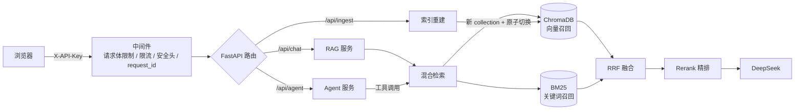

# 企业级 RAG 智能知识库

基于 **FastAPI + LangChain + ChromaDB** 的知识库问答系统：混合检索（向量 + BM25 + RRF）、Rerank 精排、带引用溯源的流式回答，以及可自主调用工具的 Agent。

项目从演示原型整理为可部署形态，内置 **API Key 鉴权、限流、结构化日志、健康探针、请求级隔离、Docker Compose 部署与 CI**。仓库不含任何真实密钥。

## 功能特性

- **两种问答模式**
  - 纯 RAG：固定「检索 → 拼上下文 → 生成」链路，回答附带来源片段与相关度
  - Agent：LLM 自主决定调用 `search_knowledge_base` / `calculator` / `get_current_time`，支持多轮记忆
- **混合检索**：向量召回 + BM25 关键词召回，RRF 融合后由硅基流动 Rerank 精排；Rerank 故障自动降级
- **SSE 流式输出**：逐 token 推送，支持前端停止生成
- **检索来源请求级隔离**：来源通过工具结果的结构化 artifact 传递，不使用全局变量，并发请求不会串数据
- **索引原子切换**：重建时写入新 collection，成功后原子更新 `ACTIVE_COLLECTION`，读写无竞争
- **安全**：常量时间密钥比较、两级滑动窗口限流、请求体大小限制、CSP 等安全响应头、统一错误体、前端零 `innerHTML`
- **可观测**：`/healthz` 存活探针、`/readyz` 就绪探针（配置 / 数据目录 / 索引）、request_id 贯穿日志与响应头
- **工程化**：分层后端、pytest（不联网）、ruff、GitHub Actions、密钥扫描脚本、Docker 多阶段构建（非 root）

## 技术栈

| 层 | 技术 |
|---|---|
| LLM | DeepSeek（OpenAI 兼容接口） |
| Embedding | 硅基流动 `BAAI/bge-large-zh-v1.5` |
| Rerank | 硅基流动 `BAAI/bge-reranker-v2-m3` |
| 向量库 | ChromaDB（本地持久化） |
| Agent | LangChain 1.x + LangGraph（MemorySaver） |
| 后端 | FastAPI + Uvicorn（单 worker） |
| 前端 | 原生 HTML / CSS / JavaScript |

## 架构



## 目录结构

```
rag-knowledge-base/
├── backend/
│   ├── main.py                 # create_app()、中间件、静态资源
│   ├── schemas.py              # 请求/响应模型
│   ├── config.py               # 兼容 shim
│   ├── ingest.py               # CLI shim：python -m backend.ingest
│   ├── api/
│   │   ├── deps.py             # API Key 校验
│   │   ├── sse.py              # SSE 编码与异常转换
│   │   ├── routes_chat.py      # /api/chat、/api/chat/stream
│   │   ├── routes_agent.py     # /api/agent、/api/agent/stream、会话删除
│   │   ├── routes_admin.py     # /api/ingest、/api/stats
│   │   └── routes_health.py    # /healthz、/readyz
│   ├── core/
│   │   ├── config.py           # pydantic-settings 配置与启动校验
│   │   ├── logging.py          # 文本/JSON 日志 + request_id
│   │   ├── errors.py           # 统一异常与错误响应
│   │   ├── security.py         # 常量时间比较、密钥指纹
│   │   ├── rate_limit.py       # 滑动窗口限流中间件
│   │   ├── middleware.py       # 请求上下文、请求体限制、安全头
│   │   └── context.py          # ContextVar
│   └── services/
│       ├── embedding.py        # 硅基流动 Embedding（分批 + 重试）
│       ├── rerank.py           # Rerank（超时 + 重试 + 降级）
│       ├── vectorstore.py      # Chroma 客户端、collection 切换
│       ├── bm25.py             # BM25 索引缓存与预热
│       ├── retrieval.py        # 混合检索 + RRF + Rerank
│       ├── rag.py              # 非流式 / 流式 RAG
│       ├── agent.py            # Agent 运行、流式、会话记忆
│       ├── tools.py            # 三个工具（安全 calculator）
│       └── ingest.py           # 文档加载、切分、原子重建
├── frontend/                   # index.html / app.js / styles.css
├── data/                       # 知识库文档（.md / .txt）
├── scripts/
│   ├── check_secrets.py        # 提交前密钥扫描
│   └── eval_retrieval.py       # 检索命中率评测
├── tests/                      # 不联网的单元/接口测试
├── .github/workflows/ci.yml
├── Dockerfile
├── docker-compose.yml
├── .env.example
├── requirements.txt / requirements-dev.txt
├── run.py
└── eval_retrieval.py           # 兼容入口
```

## 快速开始

### 方式一：Docker Compose（推荐）

```bash
cp .env.example .env
# 编辑 .env：
#   DEEPSEEK_API_KEY=...
#   SILICONFLOW_API_KEY=...
#   API_KEYS=<用下面的命令生成>
python -c "import secrets; print(secrets.token_urlsafe(32))"

docker compose up -d --build
docker compose logs -f app
```

打开 **http://localhost:8000**，在页面右上角「设置」里填入 `API_KEYS` 中的任意一把密钥，然后点击「重建索引」。

- 默认端口只绑定 `127.0.0.1`。需要局域网访问：`BIND_ADDR=0.0.0.0 docker compose up -d`
- 索引保存在命名卷 `chroma_data`，容器重建不丢失
- `data/` 以只读方式挂载，新增文档后调用 `/api/ingest` 或点击页面按钮即可

### 方式二：本地运行

```bash
conda activate ai-app
pip install -r requirements.txt

cp .env.example .env         # 填入密钥
python run.py                # 或 uvicorn backend.main:app --workers 1
```

也可以先离线建索引：

```bash
python -m backend.ingest
```

> Windows 终端如遇中文乱码，命令前加 `PYTHONUTF8=1`。

### 开发与检查

```bash
pip install -r requirements-dev.txt
pytest -q                    # 26 个测试，全程 monkeypatch，不联网
ruff check .
python scripts/check_secrets.py
python scripts/eval_retrieval.py   # 需要真实密钥与已建索引
```

`make help` 可查看全部快捷命令。

## 配置

复制 `.env.example` 为 `.env`。所有配置均支持环境变量覆盖。

### 必填（生产环境）

| 变量 | 说明 |
|---|---|
| `DEEPSEEK_API_KEY` | DeepSeek 对话模型密钥（[申请](https://platform.deepseek.com)） |
| `SILICONFLOW_API_KEY` | 硅基流动 Embedding / Rerank 密钥（[申请](https://cloud.siliconflow.cn)） |
| `API_KEYS` | 调用 `/api/*` 的访问密钥，逗号分隔支持轮换；**生产环境必填** |

### 运行环境

| 变量 | 默认值 | 说明 |
|---|---|---|
| `APP_ENV` | `development` | `development` / `production` / `test`；生产模式启动时强制校验密钥 |
| `HOST` / `PORT` | `0.0.0.0` / `8000` | 本地启动监听地址；Docker 内固定为 `0.0.0.0:8000` |
| `LOG_LEVEL` | `INFO` | 日志级别 |
| `LOG_FORMAT` | `text` | `text` 或 `json`（便于日志采集） |
| `CORS_ORIGINS` | 空 | 允许的跨域来源，逗号分隔；留空仅同源 |

### 访问控制

| 变量 | 默认值 | 说明 |
|---|---|---|
| `RATE_LIMIT_REQUESTS` | `30` | 普通接口窗口内请求数 |
| `RATE_LIMIT_WINDOW_SECONDS` | `60` | 普通接口窗口秒数 |
| `INGEST_RATE_LIMIT_REQUESTS` | `3` | `/api/ingest` 窗口内请求数 |
| `INGEST_RATE_LIMIT_WINDOW_SECONDS` | `3600` | `/api/ingest` 窗口秒数 |

### 模型与检索

| 变量 | 默认值 | 说明 |
|---|---|---|
| `DEEPSEEK_BASE_URL` | `https://api.deepseek.com` | OpenAI 兼容地址 |
| `DEEPSEEK_MODEL` | `deepseek-chat` | 对话模型 |
| `LLM_TEMPERATURE` | `0.1` | 生成温度 |
| `LLM_TIMEOUT_SECONDS` | `60` | LLM 超时 |
| `LLM_MAX_RETRIES` | `2` | LLM 重试次数 |
| `SILICONFLOW_BASE_URL` | `https://api.siliconflow.cn/v1` | Embedding 地址 |
| `SILICONFLOW_EMBED_MODEL` | `BAAI/bge-large-zh-v1.5` | Embedding 模型 |
| `EMBED_BATCH_SIZE` | `32` | 单次向量化文本条数 |
| `HTTP_TIMEOUT_SECONDS` | `30` | 外部 HTTP 超时 |
| `RERANK_MODEL` | `BAAI/bge-reranker-v2-m3` | Rerank 模型 |
| `DATA_DIR` / `CHROMA_DIR` | `./data` / `./chroma_db` | 文档与索引路径（相对项目根目录） |
| `CHUNK_SIZE` / `CHUNK_OVERLAP` | `500` / `50` | 切分参数 |
| `TOP_K` | `3` | 纯 RAG 返回片段数 |
| `RECALL_K` | `20` | 混合检索粗召回数 |
| `RERANK_TOP_K` | `3` | 精排保留数 |
| `WARMUP_BM25` | `true` | 启动时预热 BM25 |
| `STREAM_ENABLED` | `true` | 是否开放流式接口 |

> 启动时若发现配置互相矛盾（如 `CHUNK_OVERLAP >= CHUNK_SIZE`、`RERANK_TOP_K > RECALL_K`），会直接报错。

## API

所有 `/api/*` 接口需要携带密钥，二选一：

```
X-API-Key: <你的 API_KEYS 之一>
Authorization: Bearer <你的 API_KEYS 之一>
```

`/healthz`、`/readyz`、`/` 与静态资源无需鉴权。

| 方法 | 路径 | 说明 |
|---|---|---|
| `POST` | `/api/chat` | 纯 RAG 问答，返回 `{answer, sources}` |
| `POST` | `/api/chat/stream` | 纯 RAG SSE 流式 |
| `POST` | `/api/agent` | Agent 问答，返回 `{answer, tool_calls, sources}` |
| `POST` | `/api/agent/stream` | Agent SSE 流式 |
| `DELETE` | `/api/agent/session/{session_id}` | 清空会话记忆 |
| `POST` | `/api/ingest` | 重建索引（扫描 `DATA_DIR`） |
| `GET` | `/api/stats` | 文档数、切片数、当前 collection、运行时长 |
| `GET` | `/healthz` | 存活探针（不检查依赖） |
| `GET` | `/readyz` | 就绪探针，未就绪返回 503 |

请求体：

```json
{"question": "年假每年有几天？", "session_id": "user-42"}
```

- `question`：1–2000 字符
- `session_id`：1–64 位，仅 `A-Z a-z 0-9 _ -`；纯 RAG 不使用记忆，Agent 用它隔离多轮上下文

### SSE 事件

流式接口返回 `text/event-stream`，事件按以下顺序出现：

```
event: meta
data: {"request_id":"...","mode":"rag"}

event: token
data: {"text":"年假"}

event: tool
data: {"name":"search_knowledge_base"}

event: sources
data: {"sources":[{"source":"公司员工手册.md","content":"……","score":0.91}]}

event: done
data: {"answer":"完整答案","tool_calls":["search_knowledge_base"],"sources":[...]}

event: error
data: {"code":"UPSTREAM_TIMEOUT","message":"模型服务超时，请稍后重试"}
```

`reset` 事件用于 Agent 在工具调用后清空当前已输出的草稿文本。客户端应以 `done` 中的最终答案为准。

### 错误响应

```json
{
  "error": {
    "code": "RATE_LIMITED",
    "message": "请求过于频繁，请稍后重试",
    "request_id": "f4c1..."
  }
}
```

| 状态码 | 典型场景 |
|---|---|
| 401 | 缺少或错误的 API Key |
| 409 | 已有索引重建任务在执行 |
| 413 | 请求体超过 64 KB |
| 422 | 参数校验失败 |
| 429 | 触发限流，响应头含 `Retry-After` |
| 503 | 密钥未配置、索引未就绪或上游服务不可用 |
| 502 / 504 | 上游模型错误 / 超时 |

## 检索与生成

```
文档 → 切分（中文分隔符优先）→ Embedding → ChromaDB
问题 → 向量 Top-N + BM25 Top-N → RRF 融合 → Rerank Top-K → Prompt → LLM
```

- **BM25 缓存**：首次使用时从 active collection 加载全部切片构建，重建索引后自动失效
- **Rerank 降级**：Rerank 请求失败时保留 RRF 顺序，返回分数记为 `0.0`，不阻断问答
- **索引重建**：写入 `kb_<时间戳>` 新 collection → 原子更新 `chroma_db/ACTIVE_COLLECTION` → 清理过期 collection；重建期间旧索引仍可读

## 安全说明

1. **密钥绝不入库**：`.env`、`chroma_db/`、日志均被 `.gitignore` 与 `.dockerignore` 排除；镜像内不包含 `.env`（CI 会检查）
2. **分享前自检**：`python scripts/check_secrets.py` 扫描 git 追踪与未忽略文件中的常见密钥格式，发现即非零退出
3. **生产必须设置 `APP_ENV=production`**：缺失 LLM / Embedding / API Key 时启动失败；同时关闭 `/docs` 与 `/openapi.json`
4. **传输安全**：生产部署请置于 Nginx / Caddy 之后并启用 HTTPS；容器默认只绑定 `127.0.0.1`
5. **密钥轮换**：`API_KEYS` 支持逗号分隔多把密钥，可先加入新密钥、客户端切换后再移除旧密钥
6. **限流粒度**：按「客户端 IP + API Key 指纹」计数，`/api/ingest` 使用独立且更严格的窗口
7. **日志脱敏**：只记录密钥 sha256 指纹前 12 位，不记录完整 key、Authorization 头
8. **XSS**：前端所有动态内容使用 `textContent` 构建，配合严格 CSP（禁止内联脚本/样式）

> 如果真实密钥曾经被提交或分享，请立即在服务商控制台吊销并重新生成；仅删除文件并不能消除历史记录中的泄漏。

### 更换访问密钥

访问密钥保存在项目根目录的 `.env` 中（`API_KEYS=` 一行，已被 git 忽略，不会上传）。查看与更换：

```bash
# 1. 查看当前密钥（仅在本机终端执行）
grep '^API_KEYS=' .env

# 2. 生成新密钥
python -c "import secrets; print(secrets.token_urlsafe(32))"

# 3. 编辑 .env，把 API_KEYS= 后面的值替换为新密钥
# 4. 重建容器，让新配置生效
docker compose up -d --force-recreate
```

然后在前端「设置」中填入新密钥，旧密钥立即失效。

需要平滑轮换、不中断调用方时，可同时配置多把密钥：

```
API_KEYS=旧密钥,新密钥
```

待所有调用方切换完成后，再移除旧密钥并重建容器。

> 注意：仅执行 `docker compose restart` 不会重新读取 `.env`，必须使用 `up -d --force-recreate`（或 `down` 后 `up -d`）。本地非 Docker 方式运行则重启 `python run.py` 即可。

## 已知限制

- **单 worker**：会话记忆（MemorySaver）、BM25 缓存与限流计数都在进程内，水平扩展需要外部存储（Redis / 数据库）。因此 Docker 固定 `--workers 1`、`replicas: 1`
- **ChromaDB 本地模式**：适合单机、中小规模知识库；大规模/多副本场景建议迁移到独立向量数据库
- **会话记忆不持久化**：进程重启后 Agent 多轮上下文丢失
- **重建索引是同步任务**：接口会等待 embedding 完成；已有任务执行时返回 409
- **前端密钥存于 `sessionStorage`**：关闭标签页即清除，适合内部工具，不适合公开多租户场景

## 评测

`scripts/eval_retrieval.py` 内置 31 个带黄金关键词的问题，对比三种检索方式的 Top-1 / Top-3 命中率：

```bash
python scripts/eval_retrieval.py
```

评测会真实调用 Embedding 与 Rerank，需要 `.env` 中配置有效密钥并已建好索引。

## 常见问题

**Q：为什么不用 `OpenAIEmbeddings`？**
A：其默认请求参数与硅基流动接口不兼容（400），因此自定义了 `SiliconFlowEmbedding`。

**Q：Windows 下报 GBK 编码错误？**
A：命令前加 `PYTHONUTF8=1`，或设置系统环境变量 `PYTHONUTF8=1`。

**Q：想换其他 LLM / Embedding？**
A：修改 `.env` 中的 `BASE_URL`、`MODEL`、`*_API_KEY` 即可；只要接口兼容 OpenAI 协议，无需改代码。

**Q：为什么没有 API Key 也能在本地启动？**
A：`APP_ENV=development` 时允许缺省密钥以便调试，但 `/readyz` 会标记未就绪，问答接口返回 503。生产环境会直接拒绝启动。

**Q：修改了 `data/` 里的文档，为什么回答没变？**
A：需要重建索引：页面点击「重建索引」，或 `curl -X POST -H "X-API-Key: ..." http://localhost:8000/api/ingest`。

**Q：Docker 构建失败 / 路径含中文？**
A：Docker Desktop 通常支持中文路径；若构建上下文异常，将项目复制到纯英文路径后重试。

**Q：拉取 `python:3.11-slim` 超时？**
A：部分网络无法直连 Docker Hub。可先从可用镜像站拉取并重命名（请自行确认镜像来源可信）：

```bash
docker pull docker.m.daocloud.io/library/python:3.11-slim
docker tag docker.m.daocloud.io/library/python:3.11-slim python:3.11-slim
docker compose up -d --build
```

也可在 Docker Desktop 中配置 HTTPS 代理或镜像加速器后重试。

**Q：如何水平扩展？**
A：当前版本不支持直接多副本。需要将会话记忆、BM25 缓存、限流计数外置，并将 Chroma 替换为服务端向量库后，才能安全地增加 worker/副本。

## 许可证

[MIT](LICENSE)
